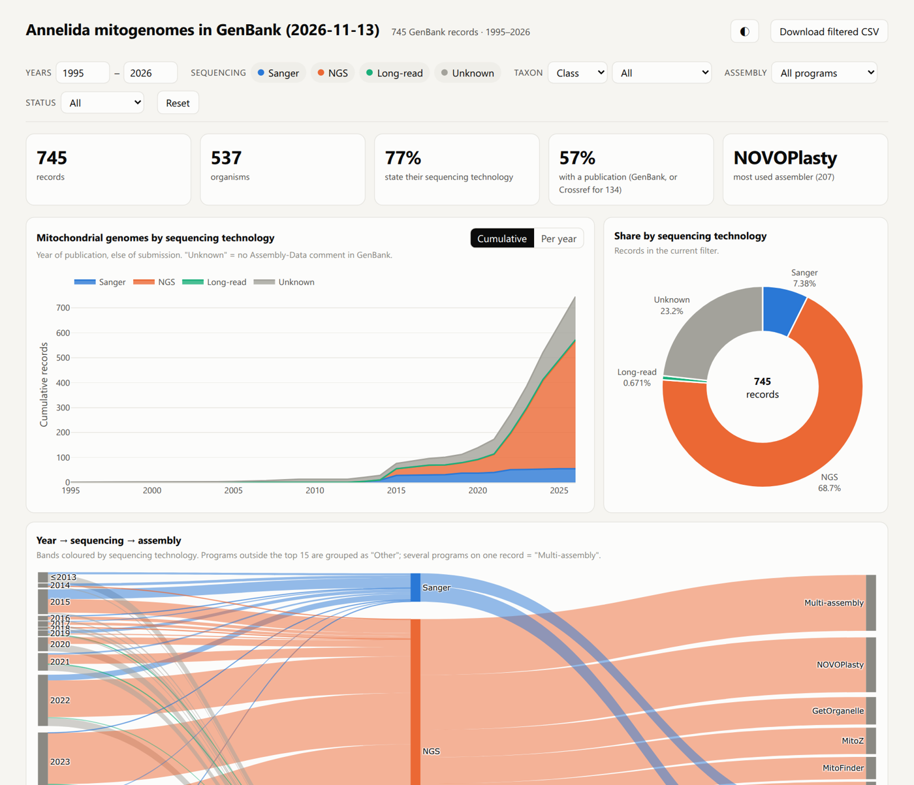

<div align="center">


# g2t — GenBank to Taxonomy

**From an NCBI taxon name to a specimen × gene matrix, and to a report on how its mitogenomes were sequenced, assembled and published.**

[](CHANGELOG.md)
[](pyproject.toml)
[](LICENSE)
[](https://deyuanyang92-dev.github.io/gb2taxonomy/demo/annelida_mitostats.html)

[Quick start](#quick-start) · [Tutorials](#tutorials) · [Live demo](https://deyuanyang92-dev.github.io/gb2taxonomy/demo/annelida_mitostats.html) · [中文说明](USAGE.md) · [English manual](USAGE.en.md) · [CLI reference](docs/CLI_REFERENCE.md) · [Changelog](CHANGELOG.md)

<a href="https://deyuanyang92-dev.github.io/gb2taxonomy/demo/annelida_mitostats.html"></a>

<sub>Interactive report written by <code>g2t-mitostats</code> for all 745 annelid mitogenomes in GenBank (November 2026) — filter by year, sequencing technology, taxon, assembler and publication status.</sub>

</div>

## Why g2t

- **GenBank metadata is messy.** One specimen's COI, 16S and 28S carry three spellings of its voucher; gene names hide in free-text titles; assembly programs are written "getorangelle" or "GetOrgnelle". g2t reads every record, normalises these fields with documented rules (`gene_dict.yaml`, `mito_methods.yaml`) and keeps the raw value next to each normalised one, so every decision can be checked.
- **Downloads are incremental.** Records are stored by `accession.version`; re-running a download fetches only new or updated records. For mitogenome statistics, `--header-only` skips the sequences: 143 k metazoan mitogenomes fit in ~0.35 GB instead of ~2.5 GB.
- **Publications are out of date.** Most submitters never tell GenBank that their paper appeared. `g2t-cite` finds it on Crossref by title and authors and writes a correction table for `g2t-curate`.
- **Checked on real data.** All 150,025 metazoan mitogenomes in GenBank were downloaded, re-run incrementally (1 min 15 s instead of 68 min) and summarised; what broke at that scale was fixed. An [evaluation on Enchytraeidae](docs/evaluation/rdna-regions.md) tests whether records sit in the right gene column.
- **Everything is a file you can open.** CSV and Excel for tables, PNG/PDF for figures, a single offline HTML file for the interactive report.

## What it does

| Command | Input → output | Typical use |
|---|---|---|
| `g2t-download` | taxon name / taxid → GenBank batch files (`--header-only`: record headers only) | get the data, update it later |
| `g2t` (steps 1–4) | GenBank files → specimen × gene matrix | multi-locus phylogeny, taxonomy |
| `g2t-curate` (step 6) | matrix + your table → corrected matrix with a change log | fix coordinates, names, references |
| `g2t-mitostats` | mitogenome records → tables, thesis-style figures, interactive HTML report | how were the mitogenomes of a clade sequenced and assembled, and where were they published? |
| `g2t-cite` | records marked "Unpublished" → their papers on Crossref | complete the journal information |
| `g2t-screen` | records + g2t types → per marker, sequences almost identical to another genus or far from all others (possible contamination or misidentification); runs as step 5 of `g2t` | find what used to take align → distances → tree by hand, e.g. Opheliidae COI OQ417162 "Polyophthalmus pictus" 0.4% from *Armandia* |
| `g2t-verify` | records + g2t types → which rRNA the sequence really is (12S, 16S, 18S, 5.8S, 28S, ITS1/ITS2), with coordinates and cut regions | catch mislabelled records, e.g. 16S titled "small subunit" (Hesionidae) or "18S…ITS…28S" records holding only ITS |

## Installation

```bash
git clone https://github.com/deyuanyang92-dev/gb2taxonomy.git
cd gb2taxonomy
pip install -e ".[report]"      # [report] adds matplotlib + plotly for g2t-mitostats
g2t --help
```

Requirements: Python ≥ 3.9, pandas ≥ 1.5, Biopython ≥ 1.80, openpyxl ≥ 3.0 (Excel files of step 6, `g2t-curate`, `g2t-cite`), pyyaml ≥ 6.0 (reads the bundled gene dictionary `gene_dict.yaml`, the only copy of the synonyms), pyhmmer ≥ 0.10 (step 2b; not on Windows, where step 2b is skipped). The columns Class/Order/Family/Genus come from ete3 if it works; otherwise (e.g. on Python 3.13, where ete3 cannot be imported) they are fetched once from NCBI Taxonomy by TaxonID and cached in `gb_metadata/taxonomy_cache.json`. Without network access they stay empty and a warning says so. `g2t-mitostats` figures need matplotlib, its HTML report plotly (`pip install -e ".[report]"`).

## Quick start

**A. Specimen × gene matrix** (Priapulidae, ~1 min):

```bash
g2t-download -t Priapulidae -o gb --dry-run       # what does NCBI hold?
g2t-download -t Priapulidae -o gb                 # -> gb/markers/batch_0001.gb ...
g2t -i gb/markers -o out --stream                 # -> out/organized_genes/organized_species_voucher.csv
```

Example (Priapulidae, NCBI txid37891, October 2026): 95,726 nuccore records, of which 69,704 are WGS contigs and 23,053 mRNA. The default selection keeps 548 marker records → 496 assigned to 7 gene types → 316 specimens, 128 with ≥ 2 genes (435 specimens and 46 with ≥ 2 genes when voucher variants are not reconciled, `--skip_reconcile`).

**B. Mitogenome sequencing / assembly report** (Annelida, ~1 min, 1.7 MB):

```bash
g2t-download -t Annelida -o gb --mitogenome --header-only   # headers only, no sequences
g2t-cite -i gb/mitogenome-header -o mito/cite.xlsx          # optional: papers of "Unpublished" records
g2t-mitostats -i gb/mitogenome-header -o mito --citations mito/cite.xlsx
# open mito/mitostats_report.html
```

Annelida, November 2026: 745 mitogenomes; NGS 512, Sanger 68, long-read 5, Unknown 160 (no Assembly-Data comment, submitted 2013 or later); NOVOPlasty is the commonest single assembler (106), 108 records name several.

## Tutorials

Step-by-step, with real data, the exact commands, and what the output looks like (in Chinese; commands and outputs are language-neutral):

| Tutorial | Data | Commands |
|---|---|---|
| [Mitogenomes of a clade: sequencing, assembly, journals](docs/tutorials/mitogenome-stats.md) | Annelida, 745 records | `g2t-download --header-only`, `g2t-mitostats`, `g2t-cite` |
| [All metazoan mitogenomes, and keeping them up to date](docs/tutorials/metazoa.md) | Metazoa, ~143 k records | `g2t-download --header-only`, reruns, `g2t-mitostats` |
| [Specimen × gene matrix](docs/tutorials/matrix.md) | Priapulidae; offline sample [`examples/haplotaxidae`](examples/haplotaxidae) | `g2t-download`, `g2t`, `g2t-curate` |

## Usage

### Step 0 — download (`g2t-download`)

| Option | Selection |
|---|---|
| *(default)* | "markers": all records except WGS contigs, mRNA, TSA (transcriptome shotgun assembly) contigs and RefSeq (predicted models and NC_/NR_ copies of INSDC records) |
| `--all` | everything, including WGS/mRNA/RefSeq (can be very large) |
| `--mito` | mitochondrial records |
| `--mitogenome` | complete mitochondrial genomes (≥ 10 kb, no upper limit; includes "genome assembly, organelle: mitochondrion" records) |
| `--gene COI,18S,28S` | given genes (COI COII COIII CYTB ND1 ND2 ND3 ND4 ND4L ND5 ND6 ATP6 ATP8 12S 16S 18S 28S 5.8S ITS H3 EF1A RPB2 RBCL MATK TRNL-TRNF PSBA-TRNH RPL16 RPS16 NDHF RPOC1 YCF1 RPL32-TRNL TRNS-TRNG ATPF-ATPH PETB-PETD PSBE-PETL RBCL-ATPB TRNK RPS4 ATPB; see `src/g2t/ncbi_genes.py`) |
| `--minlen N --maxlen N` | length range (bp) |
| `--query '…'` | any extra Entrez clause, e.g. `'Russia[Country]'` |
| `--include-wgs` / `--include-mrna` / `--include-tsa` / `--include-refseq` | add back an excluded class (TSA is excluded with `NOT "tsa"[Keyword]`) |
| `--include-large` | keep records > 100 kb (skipped by default) |
| `-n`, `--dry-run` | report taxon composition (WGS, mRNA, TSA, …), records per gene, records to fetch; write nothing |
| `--since auto` / `--since 2026-01-01` | incremental: only records created or modified in NCBI ([MDAT]) since the last download (minus 3 days) or the date; cannot see withdrawn records, so run without `--since` now and then |
| `--no-store` | no SQLite store: the selection's batch files are the only copy (new records → new batch files, superseded versions removed) |
| `--header-only` | record headers without the sequence (~12× smaller); true lengths and dates in `summary.tsv`. For `g2t-mitostats` / `g2t-cite`, not for the matrix |
| `--summary-only` | no records: only `summary.tsv` (accession, length, create/update date, taxid, title) from esummary — the fastest way to count records per year or taxon |
| `-a FILE`, `--accessions FILE` | instead of `-t`: exactly the accessions in FILE (one per line, or the first column of a .csv/.tsv; a missing version gets the current one); store, `--header-only` and reruns work the same |
| `--report` | also count composition and records per gene while downloading (about 23 extra searches, slow on big taxa; skipped by default) |

- `-t` accepts a taxon name or an NCBI taxid. Each selection is saved in its own sub-directory, named after the options (`markers`, `mito`, `mitogenome`, `gene-COI_18S`, `incl-wgs`, `all-mito`, `custom-1a2b3c` for a `--query` (hash of the query), … or `--tag NAME`), together with `accessions.tsv` and `manifest.json` (query, date, accession-list checksum, completion status).
- Nuclear records longer than 100 kb (chromosomes and genome scaffolds; a single one can be hundreds of MB) are skipped (mitochondrial and other organelle records are never capped) unless `--include-large` (or an explicit `--minlen/--maxlen`) is given; the pre-flight report shows how many there are.
- **Record store, incremental updates.** Every record is kept by `accession.version` in a SQLite store (`<out>/_records.sqlite`, or `--store PATH` to share one store between taxa). Each run re-reads the accession list from NCBI and fetches only the accession.versions not in the store, so re-running a download, choosing another selection of the same taxon, or downloading an overlapping taxon (a family, then its order) reuses what is already there; a new version (`.2`) is fetched. Batch files written by older g2t versions are imported instead of re-fetched. `<out>/<tag>/batch_NNNN.gb` is then rewritten from the store, so the pipeline sees the usual files. Differences from the previous run (new / updated / removed records) go to `changes.tsv` and are appended to `changes_history.tsv`; if g2t's own default query changed, they are marked "(query changed)". `-w N` sets parallel requests (default 3, or 8 when an API key is set); progress lines show records fetched, records per minute and the estimated time left; records are fetched 500 per request with gzip transfer and a 60 s stall timeout. A directory created for one query is never reused for another when it was named with `--tag` (error). `--dry-run` writes nothing and reports how many records are already stored.
- NCBI asks for an e-mail address: `-e you@example.org` or the variable `NCBI_EMAIL`. With an API key (`-k` or `NCBI_API_KEY`) NCBI allows 10 instead of 3 requests per second.
- `scripts/download_entrez.py` is a wrapper around `g2t-download`. Its options are compatible with the old script, but the default selection (markers instead of all records), the output location (`<out>/<tag>/`) and the batch size changed (500 again since the record store); use `--all` for the old default.

### Mitogenome statistics (`--header-only`, `g2t-mitostats`, `g2t-cite`)

How were the mitogenomes of a clade sequenced and assembled, when, and where were they published? These fields sit in the record header (`##Assembly-Data##` comment, REFERENCE), so the sequences are not needed:

```bash
g2t-download -t Annelida -o gb --mitogenome --header-only      # -> gb/mitogenome-header/, ~12x smaller
g2t-cite -i gb/mitogenome-header -o mito/cite.xlsx             # optional, see below
g2t-mitostats -i gb/mitogenome-header -o mito --citations mito/cite.xlsx
```

- `--header-only` fetches each record with `seq_start=1&seq_stop=1` (the LOCUS line then says `1 bp`); true length, dates and taxid come from esummary and are written to `summary.tsv`. Headers are stored in their own `_records_header.sqlite`, so a later full download never mistakes them for full records. Reruns fetch and summarise only new accession.versions.
- `g2t-mitostats` writes `mitostats.csv` (one row per record, raw text next to the normalised value), `counts_by_year.csv`, `counts_by_assembler.csv`, `counts_by_journal.csv`, `fig_seqtech_by_year.{png,pdf}` (cumulative records by sequencing technology, with a pie of the totals), `fig_alluvial.{png,pdf}` (year → sequencing technology → assembler) and `mitostats_report.html`: one offline file with filters for years, technology, taxon (class, order, family, genus), assembler and publication status, charts that follow the filters, a sortable table linked to NCBI and a CSV download of the filtered rows.
- **Rules** (`src/g2t/data/mito_methods.yaml`, editable): a long-read platform makes a record "Long-read" (hybrid assemblies included); otherwise any NGS platform makes it "NGS" (Sanger then only closed gaps); otherwise "Sanger". **Records without an Assembly-Data comment:** NGS if the paper title names a high-throughput method (454, Illumina, NGS, genome skimming …); Sanger if first submitted before 2012 — NCBI introduced the comment in 2012, none of the 150,025 metazoan records submitted earlier has it, and among the first annotated records (2012) Sanger outnumbers NGS 195 to 66; otherwise "Unknown". Column `seq_basis` says which rule applied. Assembler spellings found in GenBank (incl. typos such as "getorangelle") map to one name; trimming, QC, mapping and annotation tools (Trimmomatic, FastQC, MITOS, GapCloser…) are dropped; a record naming two assemblers is "Multi-assembly", one naming none "Not stated". A record naming only reference-mapping or consensus tools (BWA, MIA, bcftools, GATK…) is "Reference mapping" — 37,394 of the 150,025 metazoan records, mostly human. Year = publication year, else the year of the direct submission, else the record's creation date (`year_source` says which). `--exclude "Homo sapiens"` (repeatable; species, genus, family, order, class or phylum) leaves taxa out — humans are 46% of all metazoan mitogenome records.
- `g2t-cite` groups records whose references are all "Unpublished" by (title, authors), searches Crossref by title and first author, and grades the best paper: **high** (title similarity ≥ 0.90 and ≥ half of the authors shared), **medium** (≥ 0.75 and ≥ half), **check** (title changed but ≥ 3/4 of the authors shared, or a near-identical template title with few shared authors), **low**. A paper whose title does not name the record's taxon (when the GenBank title does) scores 0, since mitogenome notes share template titles. Sheet *Curate* (high + medium, one row per accession) is table B for `g2t-curate` and the input of `g2t-mitostats --citations`; sheet *Candidates* shows every group with its scores, "check" rows in yellow. Crossref answers are cached (`crossref_cache.json`), so reruns query only new groups. No e-mail is sent unless you pass `--mailto` (or set `CROSSREF_MAILTO`), which puts you in Crossref's faster "polite pool".

### Checking gene types against the sequence (`g2t-verify`)

```bash
pip install pyhmmer                                   # or pip install -e ".[verify]"
g2t-verify -i gb/markers --g2t out -o verify          # rRNA, unmatched and conflicted records
```

g2t assigns gene types from record titles. `g2t-verify` scans the sequences with profile HMMs (HMMER via pyhmmer) of mitochondrial 12S and 16S and nuclear 18S, 5.8S and 28S rRNA, locates each region, derives ITS1/ITS2 from the 5.8S, and reports per record `agree`, `partly`, `different`, `no_hit`, `unverifiable` (spacer only, nothing to place it by) or `new` (unmatched by g2t, but an rRNA). Output: `verify.csv` and `regions/*.fa` (sequences cut by region). Models: Rfam 15.1 profile HMMs for 18S/5.8S/28S (CC0, bundled) and barrnap 0.9 `mito.hmm` for 12S/16S (GPL-3.0, downloaded on first use and checked by SHA-256); `--models` takes your own. Evaluation, with the numbers: [docs/evaluation/rdna-regions.md](docs/evaluation/rdna-regions.md). Hesionidae: of 904 rRNA records, 5 titled "small subunit ribosomal RNA; mitochondrial" are 16S (confirmed by 98–100% identity to 16S records), invisible to the title-based conflict check. Speed: 4,750 Enchytraeidae records in 83 s on a busy 16-core machine (11 min 36 s before tiling the long models, scanning each distinct sequence once and using all cores); hits are cached, so a rerun takes 9 s (`--no-cache` to switch off).

### Steps 1–5 — the pipeline (`g2t`)

```bash
g2t -i GB_DIR_OR_FILES -o OUT --stream [--resume] [--skip_reconcile] [--reconcile_min_confidence high] [--no-verify] [--no-screen]
```

Since v0.05 the pipeline checks rRNA records against their sequence (step 2b, `g2t-verify`) and uses the sequence's gene type where it differs from the title / annotation, and screens every marker for possible contamination or misidentification (step 5, `g2t-screen`). `--no-verify` keeps the annotation's types (as in v0.04); `--no-screen` skips the screen. Evaluation: [docs/evaluation/v0.05.md](docs/evaluation/v0.05.md).

Input: GenBank flat files (`.gb`, `.gbf`, `.gbk`, `.gbff`, `.genbank`) or directories holding them. A small dataset to try offline is in [`examples/haplotaxidae`](examples/haplotaxidae) (347 records, about 4 s). Every command prints its version with `--version`.

| Step | Command | Input → output |
|---|---|---|
| 1 | `g2t-extract -i gb/markers -o s1` | GenBank → `final.csv` (one row per record: accession, length, definition, organism, voucher, isolate, locality, coordinates, date, references, …) |
| 2 | `g2t-classify -i s1/final.csv -o s2` | → `assigned_genes_types_all.csv` (gene type per record), `unmatched_sequences.csv`, `filtered_records.csv`, `record_status.csv` |
| 2b | `g2t-verify -i gb/markers --g2t OUT -o OUT/verified_rrna` | rRNA types from the sequence (in `g2t`: applied to step 2's tables; annotation kept in `*.annotation.csv`) |
| 3 | `g2t-voucher -i s2/assigned_genes_types_all.csv -o s3` | → `updated_species_voucher.csv` (specimen key = organism + voucher) |
| 3b | `g2t-reconcile -i s3/updated_species_voucher.csv -o s3` | → `reconciled_species_voucher.csv`, `reconcile_report.csv` |
| 4 | `g2t-organize -i s3/reconciled_species_voucher.csv -o matrix.csv` | → specimen × gene matrix |
| 5 | `g2t-screen -i gb/markers --g2t OUT` | → `organized_genes/screen.csv`; matrix column `screen_flags` |
| 6 | `g2t-curate -m matrix_A.xlsx -u your_table_B.xlsx -o curated_C.xlsx` | → corrected matrix C (sheets Matrix / Changes / Problems / Column mapping / Matrix (GenBank)) (optional) |

Output of the full pipeline:

```
OUT/
├── gb_metadata/final.csv                              step 1
├── gb_metadata/extraction_report.json                 step 1 (per file: status, records parsed / expected, errors)
├── labeled_genes/assigned_genes_types_all.csv         step 2
├── labeled_genes/unmatched_sequences.csv              step 2 (no gene type found)
├── labeled_genes/filtered_records.csv                 step 2 (records removed by a filter, with the reason)
├── labeled_genes/record_status.csv                    step 2 (every input record: assigned / unmatched / filtered + reason)
├── labeled_genes/*.annotation.csv                     step 2 before step 2b (types from the annotation only)
├── verified_rrna/verify.csv, regions/*.fa             step 2b (per rRNA record: annotation vs sequence, regions)
├── updated_species_vouchers/updated_species_voucher.csv     step 3
├── updated_species_vouchers/reconciled_species_voucher.csv  step 3b
├── updated_species_vouchers/reconcile_report.csv            step 3b (every candidate pair + decision)
├── organized_genes/organized_species_voucher.csv      step 4 (final matrix; column screen_flags from step 5)
├── organized_genes/screen.csv                         step 5 (flagged sequences, nearest sequence, distances)
└── g2t_run.json                                       date, command, versions of g2t/Python/Biopython/pandas/ete3, all parameters, input files (path, size, SHA-256), taxonomy source
```

`--resume` skips steps whose output exists; steps 3b and 4 are re-run when the reconcile settings differ from the previous run (stored in `OUT/.g2t_params.json`). Re-running `g2t-classify` into the same directory first removes that step's previous outputs.

Gene types (step 2): `coi`, `cox2`, `cox3`, `cob`, `nd1`–`nd6`, `nd4l`, `atp6`, `atp8`, `12s`, `16s`, `mtgenome`, `18s`, `28s`, `its1-its2`, `18-28s`, `ef-1`, `h3`; plastid (plants): `plastome`, `rbcl`, `matk`, `trnl-trnf`, `psba-trnh`, `rpl16`, `rps16`, `ndhf`, `rpoc1`, `ycf1`, `rpl32-trnl`, `trns-trng`, `atpf-atph`, `petb-petd`, `psbe-petl`, `rbcl-atpb`, `trnk`, `rps4`, `atpb` (41 types in all). Records are matched within their compartment: mitochondrial (`/organelle` or title says mitochondrion), plastid (`/organelle` plastid/chloroplast, or the title says chloroplast/plastid but not "nuclear gene for chloroplast product") or nuclear. Plastid records are checked against their own length range (150–300,000 bp, so plastomes pass); 26S/25S rRNA is typed `28s`. A circular record becomes the genome of its compartment (plastid → `plastome`, otherwise `mtgenome`). In plants (Viridiplantae, or any plastid record), a second-round match to a gene of another compartment is dropped (plastid 16S is not mitochondrial `16s`, mitochondrial rrn26 is not `28s`); in animals the gene is kept and the record flagged. Synonyms are in `src/g2t/data/gene_dict.yaml` (the only copy; from Python, `MatchConfig(gene_dict=load_path_dict(path))` adds a user file for one run). Add a spelling there, or pass your own file with `g2t-classify --path_dict` (`.txt` lines `gene: synonym 1, synonym 2`, `.csv` with columns `gene,synonyms`, or `.py` defining `gene_dict`; `.yaml` is not accepted). A new gene type also has to be listed in `g2t-classify --mtgenes_list` or `--ntgenes_list` (otherwise it is only matched in the second round, without a per-gene length range) and in `g2t-organize --gene_order` (otherwise it gets no column in the matrix); the `g2t` pipeline command does not pass these options, so run steps 2 and 4 separately.

### Voucher reconciliation (step 3b)

Submitters often write the voucher of one specimen differently for each gene (`COI_ZMMU_MSU_WS399`, `28S_ZMMU_WS399`, `WS399`), so step 3 splits the specimen into one row per gene. Step 3b merges such groups only when the records support it:

- **Placeholders**: voucher values without digits such as `n/d`, `s.n.`, `no voucher`, `NA`, `unvouchered` count as empty, so the next identifier field (isolate, …) is used.
- **Lots**: a voucher can be a lot or a herbarium sheet. If records under one voucher carry different isolates and the same gene (MCZ 70173: 7 COI), each isolate becomes its own row; `match_evidence` notes "one voucher, several individuals".
- **Candidates**: groups sharing an identifier core, taken from every identifier field (`specimen_voucher`, `isolate`, `culture_collection`, `clone`, `strain`), and either the same organism or the same genus with an identical identifier (ignoring case and punctuation: one specimen deposited as *Bathykurila* sp. and *Bathykurila* sp. AH-2023). Every letters+digits identifier of a compound voucher counts, so `ZMMU MSU WS14906` meets `COI_ZMMU_MSU_WS14906_XZ5507`): gene names, trailing notes such as "(holotype)" and punctuation are removed; a year–number pair such as `2014-1234` is kept whole; lists (`WS399, WS400`) give one core per identifier; numbers of ≥ 5 digits also match without their prefix (`USNM 123456` ~ `123456`). Other pairs (different organisms, or an organism missing) are reported, never merged; an identical identifier in different genera is flagged in `match_evidence` ("same voucher as … (different genus, …)").
- **Strong evidence**: an identical identifier (ignoring case and punctuation); the same publication (not "Direct Submission"); the same full collection date; coordinates ≤ 0.01° apart.
- **Moderate evidence**: same first author, same collector, same detailed locality; coordinates ≤ 0.5° apart; an identical identifier when both groups already hold the same gene.
- **Conflict** (blocks the merge): both groups have a `specimen_voucher` and the two share no core (an identical isolate that is a collecting-event code does not override this); the shared core is followed by different endings (lot or sub-sample numbers: `BIOUG06836-E01` / `-E02`, `SIO:BIC:A9392-1` / `-2`), or by a number on one side only (`CE438` / `CE438_2`; an added letter code such as `WS16799` / `WS16799_Pr21` is not a conflict); different institutions, collectors or sample codes around the shared core (`USNM 123456` / `MCZ 123456`, `Juslen s.n. 2003` / `Muola s.n. 2003`, `Polychaeta1D9_St95` / `Polychaeta1G8_St95`; one side without such words still merges: `WS399` / `COI_ZMMU_MSU_WS399`, `H & W 16149` / `C.B. Hellquist, J.H. Wiersema 16149`); incompatible dates, different countries, coordinates > 0.5° apart.
- **Decision**: ≥ 1 strong → merged (`high`); ≥ 2 moderate → merged (`medium`); otherwise not merged. If both groups already hold the same gene, only the same collection date or the same coordinates can merge them (a shared publication is not enough, since one paper reports many specimens); such pairs stay apart and are flagged in `match_evidence` ("similar voucher … check"). Before two specimens are joined, every pair of their records is checked, so a chain A–B–C cannot bring together A and C if they conflict, differ in organism (other than the genus rule above) or would put the same gene twice in one specimen without date/coordinate evidence.

`--reconcile_min_confidence high` merges on strong evidence only; `--skip_reconcile` turns the step off. The reconciled key uses the most frequent organism name of the merged records. Merged rows carry `match_basis`, `match_confidence` and `match_evidence` into the matrix. In the Priapulidae data (October 2026), 138 of 139 candidate pairs within a species were merged on a shared publication (the remaining pair would have joined groups with different sub-identifiers), giving 100 reconciled specimens; the identifier WS3020, used for *Halicryptus spinulosus* (28S) and *Priapulus caudatus* (COI, 16S), was reported and left unmerged.

### Vouchers in the matrix

`organism` is the most frequent name among the specimen's records; `organism_names` lists all distinct names when they differ (empty otherwise). Three voucher columns follow:

| Column | Content |
|---|---|
| `voucher_as_submitted` | every distinct `specimen_voucher` of the specimen, exactly as in GenBank (`COI_ZMMU_MSU_WS2585; 28S_ZMMU_WS2585; WS2585`) |
| `voucher_standardized` | one voucher per specimen, built from `specimen_voucher` only (empty when the specimen has only `isolate` etc.): gene names removed, the most complete form kept, written in the INSDC `/specimen_voucher` format `[<institution-code>:[<collection-code>:]]<specimen_id>` (`ZMMU:MSU:WS2585`; `ZMMU:WS30980; ZMMU_WS30980` → `ZMMU:WS30980`) |
| `voucher_note` | filled when the forms differ by more than prefixes/separators (check by hand) |

### Step 6 — correcting metadata (`g2t-curate`)

#### Purpose

Sequences are usually deposited in GenBank when a manuscript is submitted. Peer review often changes things afterwards: the specimens may be re-identified or given a new combination, the species may be described as new, the title may change, or the coordinates and dates may be corrected. Only the submitters can bring a record up to date. INSDC welcomes "corrections of errors and update of the records by authors" ([INSDC policy](https://www.insdc.org/policy/)), and NCBI asks submitters to send the publication data once the paper appears ([GenBank overview](https://www.ncbi.nlm.nih.gov/genbank/); source updates via a table, [Update GenBank records](https://www.ncbi.nlm.nih.gov/genbank/update/)). In practice many records are never updated, so the metadata of a downloaded dataset can be out of date or wrong. Misidentified and poorly annotated public sequences are well documented (Bridge et al. 2003, *New Phytologist* 160: 43–48, [doi:10.1046/j.1469-8137.2003.00861.x](https://doi.org/10.1046/j.1469-8137.2003.00861.x); Meiklejohn et al. 2019, *PLOS ONE* 14: e0217084, [doi:10.1371/journal.pone.0217084](https://doi.org/10.1371/journal.pone.0217084)).

Step 6 lets a taxonomist apply verified information to the specimen × gene matrix without editing GenBank and without losing the original values:

- **A**: the matrix built from GenBank, exactly as deposited (one specimen = one row).
- **B**: your own table, in whatever layout you already keep. It holds the information you have checked: the accepted species name, the published title and authors, corrected coordinates or dates, and extra fields such as depth.
- **C**: A corrected with B, ready for analysis.

Principles:

- **Specimen-level.** Each row of B corrects one specimen (one matrix row). Vouchers and accessions in B are used only to find that row.
- **Conservative.** If a row of B matches no specimen, matches several specimens, or its voucher and accessions point to different specimens, it is not applied. It is listed with the reason instead.
- **Traceable.** A is kept unchanged inside C. Every changed cell is logged with its old and new values and how the row was matched, and changed cells are highlighted. The log also tells you what to send to the submitters or NCBI if you want GenBank itself corrected.
- **GenBank vocabulary.** Values are written in GenBank form (`lat_lon` `66.55 N 33.10 E`, `collection_date` `12-Jun-2019`), so C stays comparable with newly downloaded data. Darwin Core field names and an NCBI source-update table are planned.

g2t does not change GenBank. C is your curated copy; the INSDC record stays the responsibility of its submitters.

#### Usage

The NCBI matrix (**A**) + your own table (**B**) → a new corrected matrix (**C**).

```bash
g2t-curate -m matrix_A.xlsx -u my_table_B.xlsx -o curated_C.xlsx
g2t-curate -m matrix_A.xlsx -u B.xlsx -o C.xlsx --map "编号=voucher" --map "Lat=latitude"   # override detection
```

**B can be any table you already keep** (Excel/csv, any column names, English or Chinese; `--sheet` picks a sheet). Columns are recognised automatically:

| B column (examples) | used as |
|---|---|
| voucher, specimen no., catalog number, 凭证号, 标本号 | locates the specimen (any written form) |
| any accession column(s): `COI accession`, `28S 登录号`, or values like `ON792938.1` | locates the specimen; all accessions in a row must point to the same specimen |
| species, scientific name, 拉丁名 | `organism` |
| latitude + longitude (decimal), 纬度 + 经度 | combined into GenBank `lat_lon` (`66.55 N 33.10 E`) |
| collection date, 采集日期 (`20190612`, `2019-06-12`) | `collection_date` in GenBank form (`12-Jun-2019`) |
| locality / 采集地, country / 国家, title / 论文题目, authors / 作者, journal / 期刊, collector / 采集人, identified by / 鉴定人 | `geo_loc_name`, `country`, `Ref1Title`, `Ref1Authors`, `Ref1Journal`, `collected_by`, `identified_by` |
| anything else (e.g. `Depth (m)`) | added to C as a new column `user:<name>` |

C's sheet *Column mapping* shows how each B column was used; *Matrix* highlights every changed cell; *Matrix (GenBank)* is A unchanged. Values identical to A are not counted as changes.

Alternatively, use a pre-filled template:

```bash
g2t-curate -m matrix.csv --template corrections.xlsx      # one row per specimen, pre-filled; keeps a baseline sheet
# edit cells in corrections.xlsx; blank cells mean "no change"
g2t-curate -m matrix.csv -u corrections.xlsx -o curated.csv
```

- Rows are located by `accession` (any gene column, version optional) and/or `voucher` (any written form, e.g. `WS2585` finds `ZMMU_MSU_WS2585`); add `organism_match` when one voucher occurs in several species. Other columns are the values to set (`organism`, `lat_lon`, `geo_loc_name`, `collection_date`, `Ref1Title`, `curation_source`, … or any new column).
- `curated.csv` gets a `curated_fields` column; `curated_curation_log.csv` lists every change (old → new, matched by); `curated_curation_problems.csv` lists rows that matched nothing, several specimens, or where accession and voucher point to different specimens — these are not applied. The input matrix is not changed.
- With a template, only the cells you edit count (compared with its `baseline (do not edit)` sheet), so unedited cells never overwrite values GenBank updated later; an edited cell whose GenBank value has also changed is reported as a conflict and not applied.
- Cells cannot be emptied through a correction (blank = keep).

### Python API

```python
import g2t
from g2t.download import DownloadOptions

r0 = g2t.download("Priapulidae", "gb", DownloadOptions(gene="COI,18S"))   # -> gb/gene-COI_18S/
res = g2t.run(input_files=[r0.out_dir], output_dir="out", stream=True)
print(res.success, res.final_output)

# single steps
g2t.extract(["gb/markers"], "s1")
g2t.classify("s1/final.csv", "s2")
g2t.voucher("s2/assigned_genes_types_all.csv", "s3")
g2t.reconcile("s3/updated_species_voucher.csv", "s3")
g2t.organize("s3/reconciled_species_voucher.csv", "matrix.csv")
```

## Limitations

1. **Gene type comes from the record's DEFINITION line, for the whole record.** A multi-region rRNA record named "18S … ITS1" or "ITS2 … 28S" is placed in every column it covers (`18s,its1-its2`, `28s,its1-its2`): the same accession appears in both columns and holds the whole record, not the separate region. Records matching other combinations of genes get all matched types (e.g. `16s,coi`, `28s,h3`) and `Conflict=True` (`Conflict_reason` "Multiple candidates…"); a mitochondrial record matching more than two genes and ≥ 3,000 bp long becomes `mtgenome` only if its title names a genome (otherwise it keeps the genes and is flagged).
2. **Sequences are not cut into genes.** The accession of a mitogenome (`mtgenome`) is copied into all mitochondrial gene columns (coi, 16s, 12s, cob, cox2, cox3, nd1–nd6, nd4l, atp6, atp8), that of a plastome into all plastid gene columns, and that of an 18S–ITS–28S record (`18-28s`) into 18s, 28s and its1-its2, **whether or not the record actually annotates that gene** (e.g. FN689349 has no 12S annotation but appears under 12s). Restrict the columns with `g2t-organize --mtgenome_includes coi 16s`. No per-gene sequence is extracted; this has to be done downstream before alignment.
3. **Length filter.** Records outside 150–50,000 bp (or without a length, or duplicated LocusIDs) are removed before classification. They are not lost silently: each is listed in `filtered_records.csv` with the reason, and `record_status.csv` gives every input record exactly one status. To classify them instead, widen all three ranges: `g2t-classify … --length_range2_all 1:1000000 --length2_mtgenes 1:1000000 --length2_ntgenes 1:1000000`.
4. **Only 41 gene types, matched by keywords.** Other loci (nuclear protein-coding genes, microsatellites, Hox genes, …) end up in `unmatched_sequences.csv` unless added to the gene dictionary (see *Gene types* above). Specimen identifiers in the DEFINITION (`isolate CO2`, `voucher COI-12`) and the English word "its" are ignored, and a few look-alikes are excluded (16S rRNA methyltransferase, histone H3 lysine/demethylase, elongation factor-1 beta/gamma), but keyword matching can still misfire on unusual wording.
5. **Vouchers and metadata.** Step 3 joins records of one organism whose voucher strings are identical, without further checks; two specimens that happen to share a code would be merged. Step 3b also joins identical identifiers (ignoring case and punctuation, in any identifier field) of one genus deposited under different names (*Bathykurila* sp. / *Bathykurila* sp. AH-2023); if both groups hold the same gene, only with the same date or coordinates; identical vouchers in different genera stay apart and are flagged in `match_evidence`. Step 3b depends on the metadata submitted to GenBank: without a shared publication, date, coordinates or collector, variants of one voucher stay unmerged (it errs on the side of not merging); when both groups already hold the same gene, a shared publication is not enough, and the pair is flagged instead. Identifiers that differ only by a lot or sub-sample ending (`CE438` / `CE438_2`) or by the institution, collector or sample code around the number (`USNM 123456` / `MCZ 123456`) are treated as different specimens. In the matrix, locality, date and other metadata are taken from the first record of the specimen that has a value, column by column, so they can come from different records; `Conflict` is true if any record was flagged.
6. **Names are taken as submitted.** Organism names are not checked against a taxonomic authority (WoRMS, NCBI synonyms); misidentified or outdated names stay as they are unless you correct them in step 6.
7. **Download.** NCBI nuccore only (no BOLD, ENA-only, or SRA data). Speed is set by NCBI E-utilities (3 requests/s without an API key, 10 with one); measured: ~12,000 mitogenome headers per minute without a key. `--gene` searches gene fields and title words, so it can miss records with unusual wording; a gene query also returns mitogenomes that contain the gene.
8. **Malformed files.** If a GenBank file has a record that Biopython cannot parse, the records after it in that file are not read; the file is marked partial in `extraction_report.json` and a warning gives the expected and parsed record counts.
9. **Mitogenome statistics and citations.** `g2t-mitostats` can only report what submitters wrote: records without an Assembly-Data comment submitted from 2012 on stay "Unknown"; older ones are counted as Sanger (inferred), so a 2006–2011 NGS record that says so neither in a comment nor in the paper title is miscounted; and an assembler not listed in `mito_methods.yaml` is reported as "Other" (`assembly_other` column) until added. `g2t-cite` depends on Crossref coverage and on the GenBank title resembling the published one: "high" and "medium" matches go to the *Curate* sheet, "check" rows need a look, and a paper whose title changed completely is not found. Check the *Candidates* sheet before using the matches in a publication.
10. **Curation (step 6).** Each row of B corrects only specimens already in A. A specimen with no GenBank record is reported as unmatched and is not added to C. A blank cell means "keep", so B cannot empty a cell of A. Column recognition is a heuristic based on names and on accession-like values; check the *Column mapping* sheet and use `--map` where it is wrong. Values from B are taken as correct: B itself is not checked against the literature or WoRMS.
11. **Code status.** v0.05 is an early release. 770 unit tests pass on Python 3.13 (2026-11-13; earlier releases were also tested on 3.12 and 3.9; on 3.9, 3 Excel tests need openpyxl); `ruff` and `mypy` are clean.

## Citation

There is no paper on g2t yet. Please cite the software and version you used:

> Yang, D. (2026). *g2t: GenBank to Taxonomy* (version v0.05) [Computer software]. GitHub. https://github.com/deyuanyang92-dev/gb2taxonomy

```bibtex
@software{yang_g2t_2026,
  author  = {Yang, Deyuan},
  title   = {g2t: GenBank to Taxonomy},
  version = {v0.05},
  year    = {2026},
  url     = {https://github.com/deyuanyang92-dev/gb2taxonomy}
}
```

GitHub's "Cite this repository" button uses [CITATION.cff](CITATION.cff). Please also cite:

- **The sequence data**: the original publications of the GenBank records you use (columns `Ref1Authors`, `Ref1Title`, `Ref1Journal` of the output) and NCBI GenBank.
- **Biopython**, used to fetch and parse records: Cock, P. J. A., Antao, T., Chang, J. T., Chapman, B. A., Cox, C. J., Dalke, A., Friedberg, I., Hamelryck, T., Kauff, F., Wilczynski, B., & de Hoon, M. J. L. (2009). Biopython: freely available Python tools for computational molecular biology and bioinformatics. *Bioinformatics*, 25(11), 1422–1423. https://doi.org/10.1093/bioinformatics/btp163

## License

MIT — see [LICENSE](LICENSE).
