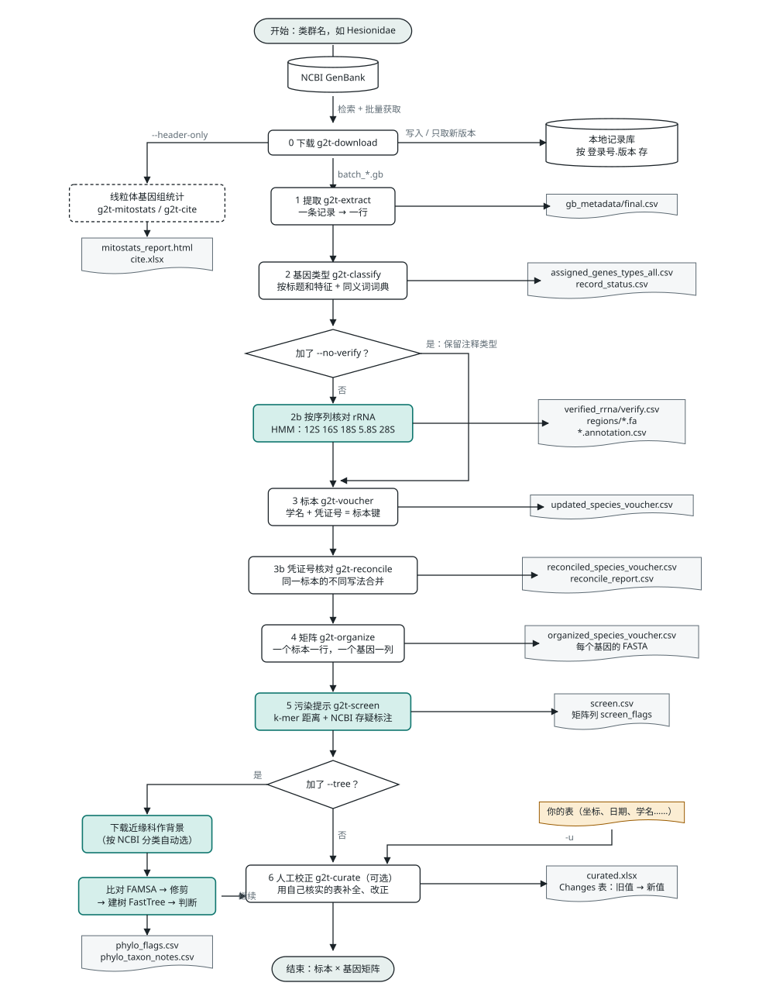
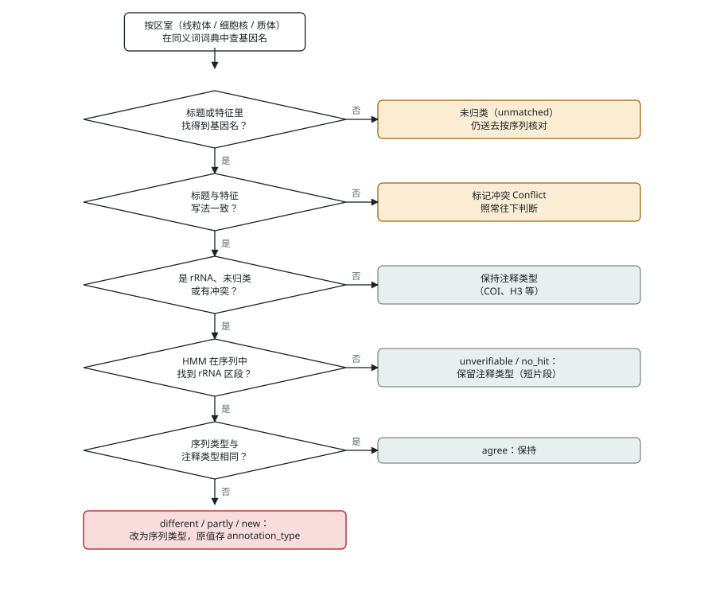
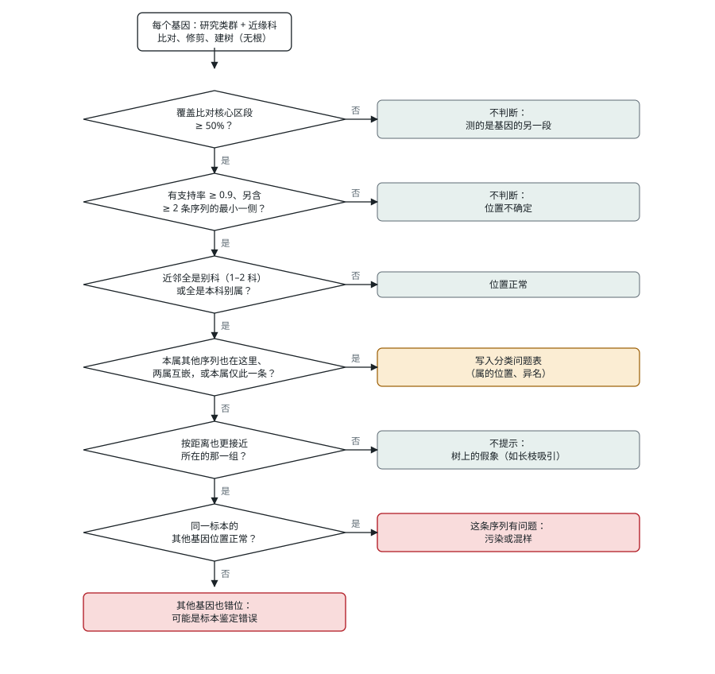
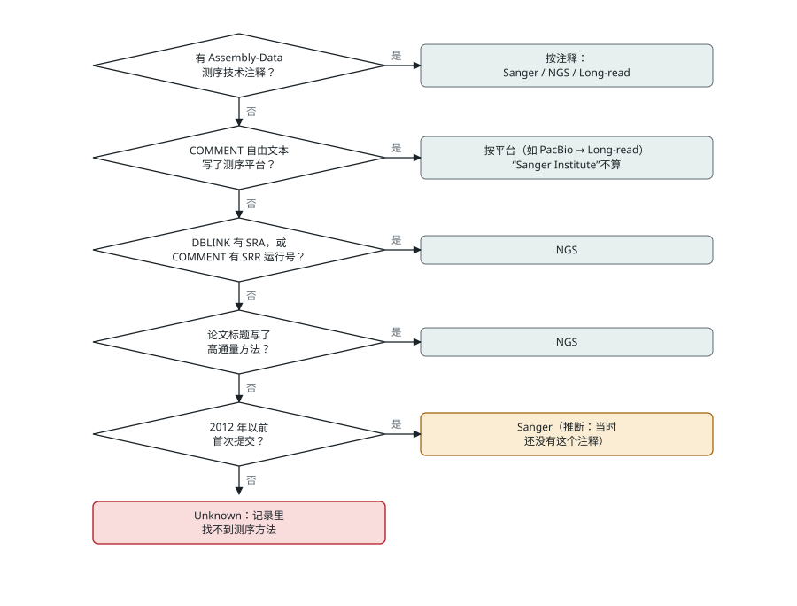

# GenBank 记录与 g2t 整理流程（图解）

[← README](../README.md) · [使用说明](../USAGE.md) · [整页交互版（HTML）](genbank-and-workflow.html)

示例记录 MG523356（海女虫科 *Amphiduropsis* cf. *axialensis*）：标题写的是线粒体“小亚基”（12S），序列实际是 16S。下面用它把 GenBank 格式和 g2t 的每一步串起来。所有结果都来自 g2t v0.06 对海女虫科数据的实际运行（2026-11-13 下载）。

## 图 1　GenBank 文本：一条记录的组成

**怎么看这张图：**

- 记录是固定列宽的纯文本：关键词占第 1–12 列，内容从第 13 列开始；特征名从第 6 列开始，限定词（`/organism=` 这类）从第 22 列开始；最后一行是 `//`。
- 左侧色条标出六个部分：记录头、物种与分类、文献、注释 COMMENT、特征表 FEATURES、序列 ORIGIN。
- 右侧是 g2t 对关键行的处理。红色两处说明这个例子的问题：第 2 步按标题判为 12S，第 2b 步按序列改为 16S。

| GenBank 字段 | 含义 | g2t 提取后的列（`final.csv`） |
|---|---|---|
| `LOCUS` `VERSION` | 登录号、版本、长度、分子类型、日期 | `ACCESSION` `Version` `Length` `Date` |
| `DEFINITION` | 标题，提交者写的，可能有错 | `Definition`；第 2 步据此判断基因类型 |
| `DBLINK` | BioProject、BioSample、SRA 原始数据 | `BioProject` `BioSample` `SRA` |
| `ORGANISM` | 学名与分类路径 | `Organism` `Taxonomy` → `Family` `Genus` |
| `REFERENCE` | 文献；“Direct Submission” 给出提交日期 | `Ref1Title` `Ref1Journal` …（全部保留） |
| `COMMENT` | 结构化注释（测序技术）与自由文本 | `Sequencing Technology` `Assembly Method` `Comment` `StructuredComment` |
| `/specimen_voucher` `/isolate` | 凭证号、分离株编号 | 同名列；第 3 步的标本键 |
| `/lat_lon` `/collection_date` `/geo_loc_name` … | 采集信息 | 同名列 |
| `/PCR_primers` | 引物名与序列 | `PCR_primers`；引物名另列 `primer_fwd` `primer_rev` |
| `ORIGIN` | 序列 | 不进表；第 2b 步核对类型，第 5 步检查污染 |

## 图 2　流程图：从 NCBI 到标本 × 基因矩阵

**图中符号：**

| 符号 | 含义 |
|---|---|
| 圆角框 | 开始 / 结束 |
| 矩形 | 处理步骤；绿色是看序列本身的步骤（第 2b、5 步） |
| 菱形 | 选项 |
| 波浪底框 | 输出文件 |
| 圆柱 | 数据库 |

**布局：** 中间一列是主流程，右侧是每一步写出的文件，左侧是两个可选分支：

- 只下载记录头（`--header-only`），做线粒体基因组统计；
- `--tree` 建树检查。

**选项：** `--no-verify` 跳过第 2b 步，保留按注释得到的类型。

## 图 3　逻辑图：三处关键判断

**3a　基因类型（第 2、2b 步）**

- 只有 rRNA、未归类和有冲突的记录才按序列核对。
- 序列与注释不同时，以序列为准。
- 模型找不到的短片段保留注释类型。
- MG523356 走的是最下面一条：注释 12s，序列 16s，改为 16s。

**3b　建树检查（`g2t-screen --tree`）**

- 前两问排除不可靠的位置。
- 第四问把分类问题（属的位置、异名）和单条记录的错误分开。
- 第五问用距离复核，排除树上的假象。
- 最后看同一标本的其他基因，区分“这条序列错了”和“标本鉴定错了”。

**3c　线粒体基因组的测序方法（`g2t-mitostats`）**

依次查看记录中的各项信息，前面的有就不再往下看。NCBI 2012 年才有 Assembly-Data 注释，所以更早的记录推断为 Sanger。

## 结果：MG523356 所在标本在矩阵中的一行

| 标本 | 凭证号 | coi | 16s | 12s | 18s | 28s |
|---|---|---|---|---|---|---|
| *Amphiduropsis* cf. *axialensis* GWR-2018 | SIO:BIC:A1758 | MG517505.1 | **MG523356.1** | — | MG649239.1 | MG649243.1 |

四个基因来自四条记录，靠凭证号合成一个标本。只按注释整理时，MG523356 会出现在 12s 列。
