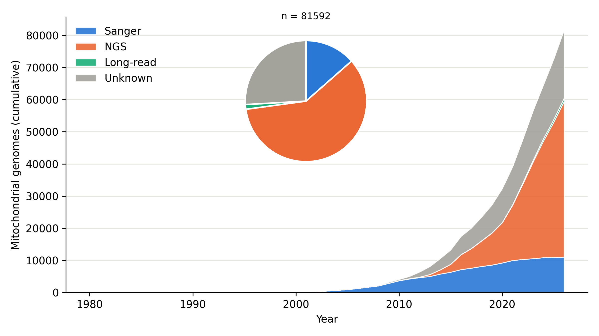

# 教程：整理 NCBI 全部后生动物线粒体基因组，并持续更新

[← README](../../README.md) · [线粒体基因组统计（Annelida）](mitogenome-stats.md) · [标本 × 基因矩阵](matrix.md)

目标：一次整理 GenBank 中全部后生动物（Metazoa，txid33208）的线粒体基因组记录，统计测序技术、组装软件和期刊；以后定期更新时只处理新增记录。本文数字是 2026-11-13 实跑结果，未设置 NCBI API key。

## 1. 第一次下载（只要记录头）

```bash
g2t-download -t Metazoa -o gb --mitogenome --header-only
```

| 项目 | 实测 |
|---|---|
| 记录数 | 150,025（不含 RefSeq、WGS、mRNA、TSA） |
| 失败 | 0（中途有几次 HTTPError、连接被重置，自动重试或拆小批次后成功） |
| 用时 | 68 分钟：约 35 分钟下载记录头，约 30 分钟取长度和日期（`summary.tsv`；这一步当时还是串行，现已改为并行） |
| 占用 | 批文件 292 MB，记录库 `_records_header.sqlite` 159 MB |

有 NCBI API key 时（`-k KEY` 或环境变量 `NCBI_API_KEY`），NCBI 允许每秒 10 次请求，g2t 默认并行数自动从 3 提到 8，应明显更快。本机没有 key，这一点未实测。

只想数“每年多少条、哪些类群”，不关心测序和组装方法时，可以只取摘要表，不下载任何记录：

```bash
g2t-download -t Metazoa -o gb --mitogenome --summary-only   # 只写 summary.tsv：登录号、长度、日期、taxid、标题
```

## 2. 以后更新：只处理新增

同一条命令再跑一次：

```bash
g2t-download -t Metazoa -o gb --mitogenome --header-only
```

```
Metazoa (txid33208, kingdom) selection 'mitogenome-header': 150025 records (reused 150025, fetched 0, failed 0); since last run: new 0, updated 0, removed 0
```

实测 1 分 15 秒（第一次 68 分钟）。这 75 秒基本是向 NCBI 取当前登录号清单。g2t 用清单与本地库比对：已有的 accession.version 直接复用，只下载新增和版本号变了的记录，`summary.tsv` 也只查询新记录。和上次相比的变化（新增、更新、被撤回）写在 `changes.tsv`，并累积到 `changes_history.tsv`。

`--since auto` 只查询上次以来 NCBI 修改过的记录（[MDAT]），更快，但看不到被撤回的记录。建议平时用 `--since auto`，隔几次跑一回不加它的完整核对。

## 3. 汇总

```bash
g2t-mitostats -i gb/mitogenome-header -o metazoa_mito
```

第一次 8 分 34 秒：大部分时间在向 NCBI 查约 3.2 万个物种的分类阶元。查过的结果缓存在 `gb/mitogenome-header/taxonomy_lineage.json`，再跑只需 47 秒。

```
150025 records; 105569 with an Assembly-Data comment
sequencing: Sanger 31615, NGS 86036, Long-read 2723, Unknown 29651
assembly:   Not stated 56226, Reference mapping 37394, Geneious 11220, GetOrganelle 7118, Sequencher 6655, CLC 4868, Multi-assembly 4710, NOVOPlasty 3778
published:  83805 (56%), 527 journals
```

交互报告 `mitostats_report.html` 约 82 MB，Chrome 中 5–6 秒打开。

### 先看清楚数据构成：人类占 46%

| 类群 | 记录数 |
|---|---|
| Mammalia | 87,859 |
| 其中 *Homo sapiens* | 68,433（占全部后生动物记录的 46%） |
| Insecta | 22,548 |
| Actinopteri | 16,900 |
| Aves | 4,980 |

人类线粒体基因组大多是把测序读段比对到参考序列后得出的一致序列，并不是从头组装。GenBank 里写的“组装方法”是 BWA、MIA、bcftools、GATK 一类比对或变异检测软件。g2t 把只写了这类软件的记录单独归为 **Reference mapping**，共 37,394 条，其中 35,226 条属于哺乳纲。研究“后生动物线粒体基因组用什么方法测序和组装”时，通常应排除人类：

```bash
g2t-mitostats -i gb/mitogenome-header -o metazoa_nohuman --exclude "Homo sapiens"
```

排除人类后（另起输出目录；分类阶元缓存在数据目录里，可直接复用）：

```
excluded Homo sapiens: 68433 records
81592 records; 55759 with an Assembly-Data comment
sequencing: Sanger 11015, NGS 48419, Long-read 1020, Unknown 21138
assembly:   Not stated 31024, Geneious 10936, Reference mapping 7636, GetOrganelle 7117, Multi-assembly 4599, NOVOPlasty 3778, SPAdes 2621, CLC 2162
published:  36521 (45%), 468 journals
```

| 截至 | Sanger | NGS | Long-read | Unknown |
|---|---|---|---|---|
| 2015 | 6,321 | 2,456 | 18 | 4,443 |
| 2020 | 9,204 | 12,495 | 96 | 10,527 |
| 2025 | 10,917 | 42,086 | 846 | 18,803 |
| 2026-11-13 | 11,015 | 48,419 | 1,020 | 21,138 |

v0.05 起，2012 年以前提交、没有 Assembly-Data 注释的记录算作 Sanger（推断）。原因：NCBI 2012 年才有这个注释，早年记录本来就没有。论文标题写明高通量方法的记录算作 NGS。v0.04 曾把这些记录都算作 Unknown：Sanger 6,544、Unknown 26,231。依据列在 `seq_basis` 列。



`--exclude` 可以重复使用，接受种名（含其亚种）或属、科、目、纲、门名，例如 `--exclude Mammalia`。

### 组装软件名称的整理

GenBank 中 "Assembly Method" 的写法五花八门。在全部后生动物数据上，第一版规则有 18,353 条记录落入 "Other"（无法识别）。按实际写法补充规则后（`src/g2t/data/mito_methods.yaml`），降到 1,699 条：

- 比对、变异检测软件归入 Reference mapping。
- Sanger 测序常用的序列编辑和拼接软件（SeqScape、CodonCode、BioEdit、UGENE、ContigExpress 等）各自识别。
- 拼写错误合并到正确名称：gnenious、genious → Geneious；novaplasty → NOVOPlasty；mito-z → MitoZ。
- 比对、建树、去接头、单倍群判定等软件不算组装，直接去掉：MAFFT、MEGA、leeHom、Trim Galore、HaploGrep 等。

剩下的 "Other" 写法列在 `mitostats.csv` 的 `assembly_other` 列。遇到常见的新写法，在 YAML 里加一行即可。

## 4. 发表时请写明口径

数字随查询式、下载日期，以及是否排除人类和 RefSeq 而变。建议在方法部分写明：

1. 查询式（见 `manifest.json` 的 `query`）。
2. 下载日期。
3. 没有 Assembly-Data 注释的记录怎么算：g2t 的做法是，论文标题写明高通量方法的算 NGS，2012 年以前提交的算 Sanger（推断），其余算 Unknown。依据见 `seq_basis` 列。
4. 年份取发表年，没有则取提交年。
5. 排除了哪些类群。
