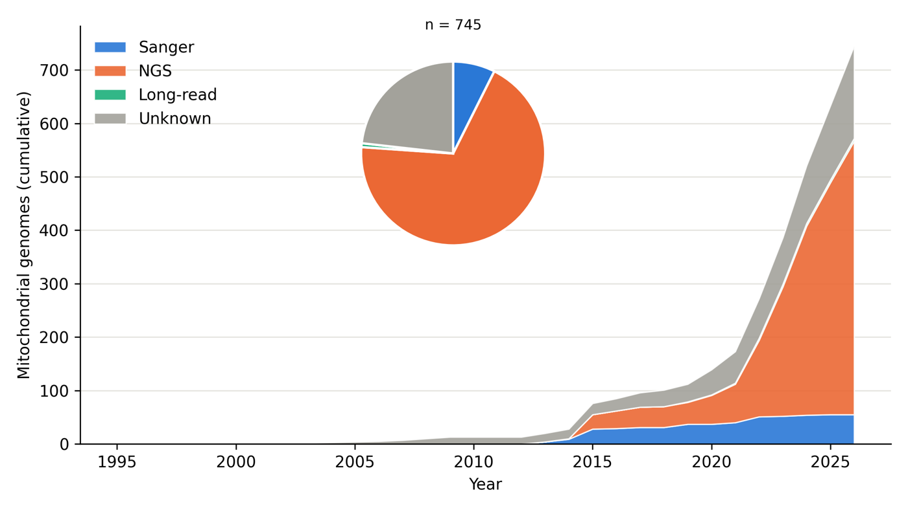
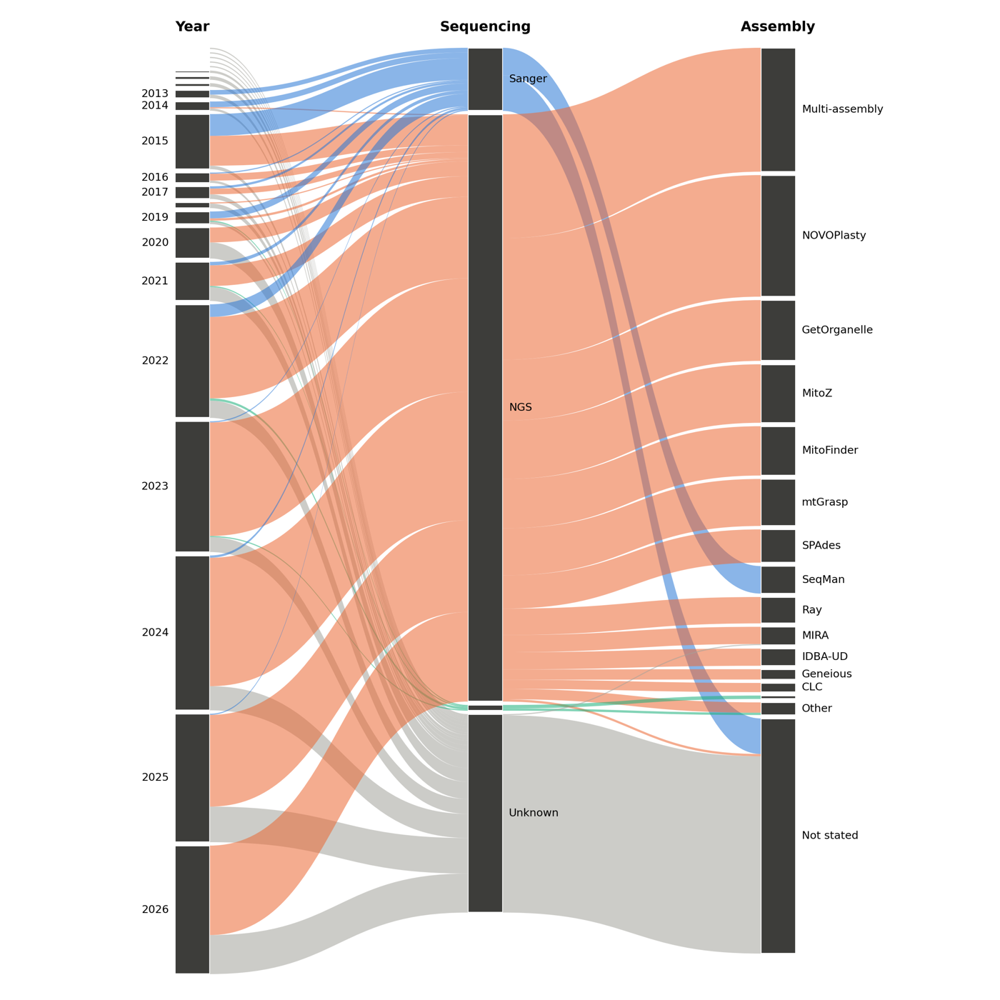
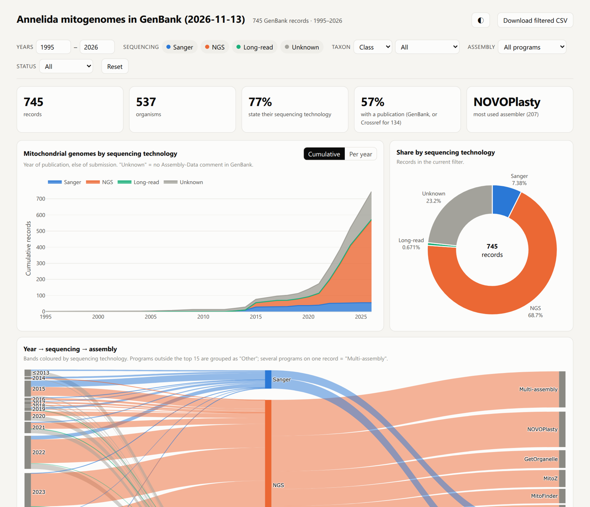

# 教程：一个类群的线粒体基因组——测序技术、组装软件、期刊

[← README](../../README.md) · [全后生动物](metazoa.md) · [标本 × 基因矩阵](matrix.md)

问题：环节动物（Annelida）在 GenBank 里有多少条线粒体基因组？每年多少？用 Sanger、二代还是三代测序？用什么软件组装？发表在哪些期刊？

这些信息都在记录头里（`##Assembly-Data##` 注释、REFERENCE），**不需要下载序列**。本教程所有数字是 2026-11-13 实跑结果；你跑的时候 NCBI 数据已更新，数字会略有不同。

在线看结果：[Annelida 交互报告](https://deyuanyang92-dev.github.io/gb2taxonomy/demo/annelida_mitostats.html)

## 1. 只下载记录头（`--header-only`）

```bash
g2t-download -t Annelida -o gb --mitogenome --header-only
```

实测：745 条，48 秒，批文件共 1.7 MB。完整记录（含序列和注释）抽 50 条比较，约是记录头的 12 倍。

```
gb/
├── _records_header.sqlite      记录头库（与完整记录的 _records.sqlite 分开，不会混用）
└── mitogenome-header/
    ├── batch_0001.gb, batch_0002.gb
    ├── summary.tsv             真实长度、建档/更新日期、taxid（记录头的 LOCUS 行只写 1 bp）
    ├── accessions.tsv
    └── manifest.json           查询式、日期、是否完整
```

`summary.tsv` 前两行：

```
accession   length  create_date  update_date  taxid    title
OZ496499.1  15637   2026-07-21   2026-11-04   2607901  Sternaspis cf. scutata NHMUK ANEA 2019 genome assembly, organelle: mitochondrion
```

`--mitogenome` 的查询式（`manifest.json` 里有原文）：线粒体、标题含 complete genome / mitogenome / mitochondrial genome / genome assembly、长度 ≥ 10 kb，不含 WGS、mRNA、TSA、RefSeq（RefSeq 的 NC_ 是 GenBank 记录的副本，算进去会重复计数）。

**更新**：以后再跑同一条命令，只下载新增或版本号变了的记录，`summary.tsv` 也只查新记录。

## 2. 汇总（`g2t-mitostats`）

```bash
g2t-mitostats -i gb/mitogenome-header -o mito
```

```
745 records; 573 with an Assembly-Data comment
sequencing: Sanger 55, NGS 512, Long-read 5, Unknown 173
assembly:   Not stated 205, Multi-assembly 108, NOVOPlasty 106, GetOrganelle 53, MitoZ 51, MitoFinder 43, mtGrasp 41, SPAdes 29
published:  294 (39%), 36 journals
years:      1995-2026
```

输出：

| 文件 | 内容 |
|---|---|
| `mitostats.csv` | 每条记录一行：原文（`seq_technology_raw`、`assembly_method_raw`、`journal_raw`）和归类结果并排，方便逐条核对 |
| `counts_by_year.csv` | 每年、累计的 Sanger / NGS / Long-read / Unknown |
| `counts_by_assembler.csv`、`counts_by_journal.csv` | 组装软件 × 测序类别；期刊 |
| `fig_seqtech_by_year.png/.pdf` | 累计面积图 + 饼图（下图） |
| `fig_alluvial.png/.pdf` | 年份 → 测序技术 → 组装软件（下图） |
| `mitostats_report.html` | 交互报告，单个离线文件，双击打开 |





### 归类规则（`src/g2t/data/mito_methods.yaml`，可自行增改）

一条记录的实际例子（`mitostats.csv`）：

| 列 | 值 |
|---|---|
| accession | OR449961.1（*Veneriserva pygoclava*） |
| seq_technology_raw → seq_category | `Illumina` → NGS |
| assembly_method_raw → assemblers | `GetOrgnelle v. 1.7.5.2` → GetOrganelle（拼写错误照样识别） |
| journal / year / year_source | Org Divers Evol / 2024 / publication |

- 测序类别：有三代平台（PacBio、Nanopore）→ Long-read（含二代 + 三代混合组装）；否则有二代平台 → NGS（此时 Sanger 只是补洞）；否则 → Sanger。
- **没有 Assembly-Data 注释的记录归 Unknown，不当作 Sanger。** Annelida 有 173 条这样的记录，并不都是早年数据：≤ 2012 年 13 条，2013–2020 年 34 条，2021–2025 年 92 条，2026 年 34 条。
- 组装软件：同一软件的各种写法（含 GenBank 里的拼写错误）合成一个名字；Trimmomatic、FastQC、MITOS、GapCloser 等不是组装软件，去掉；写了两个及以上组装软件的记为 Multi-assembly，什么都没写的记为 Not stated。认不出的写法保留在 `assembly_other` 列，最终归为 Other（Annelida 只有 1 条）。
- 年份：发表年；没发表用直接提交年；都没有用建档日期。`year_source` 列写明用了哪个。

### 交互报告



- 顶部筛选：年份范围、测序类别（点选）、分类阶元（纲/目/科/属）、组装软件、是否发表。所有图和表跟着筛选更新。
- 累计 / 逐年切换；鼠标悬停看具体数字；表格可排序，登录号直接链接到 NCBI；“Download filtered CSV” 下载当前筛选的记录。
- 深色模式（右上角按钮）、手机屏幕可用。

## 3. 只看某个亚类群或某段年份

报告里直接筛选即可。若要单独出图（比如论文只用 2015–2025 年的多毛类），在报告里筛好后点 “Download filtered CSV”，或在 Python 里：

```python
import pandas as pd
t = pd.read_csv("mito/mitostats.csv")
sub = t[(t["class"] == "Polychaeta") & t["year"].between(2015, 2025)]
print(sub.groupby(["year", "seq_category"]).size().unstack(fill_value=0))
```

## 4. 补上已发表但 GenBank 没更新的期刊（`g2t-cite`）

上面显示只有 39% 的记录在 GenBank 里有期刊，因为很多作者发表后没有回头更新记录。`g2t-cite` 用记录标题和作者到 Crossref 找对应论文：

```bash
g2t-cite -i gb/mitogenome-header -o mito/cite.xlsx
```

```
   224 unpublished records, 81 distinct (title, authors)
g2t-cite: mito/cite.xlsx  high 16, medium 9, check 11, low 45
```

81 篇（同一标题和作者的记录合并成一组）查询约 2.5 分钟。结果按把握程度分级：

| 等级 | 规则 | Annelida 组数（记录数） | 人工核对 |
|---|---|---|---|
| high | 标题相似度 ≥ 0.90，且至少一半作者相同 | 16（124） | 16 组全部正确 |
| medium | 相似度 ≥ 0.75，至少一半作者相同，且共有 ≥ 2 位作者 | 9（11） | 9 组全部正确 |
| check | 标题改动较大但 ≥ 3/4 作者相同，且标题中的物种名一致（或相似度 ≥ 0.65） | 11（11） | 按标题和作者看全部像是对的，仍需逐条确认 |
| low | 其余 | 45（78） | 不采用 |

人工核对指对照 GenBank 标题与 Crossref 标题、作者、物种名，没有逐篇打开原文。

两条防误配规则来自本例的真实错误：

- 线粒体论文标题高度模板化（"The complete mitochondrial genome of …"）。GenBank 标题写了物种名、而候选论文标题没写同一物种时，相似度记为 0。例如 *Amynthas heteropodus* 的记录曾被配到 *Amynthas deogyusanensis* 的论文。
- 只共有一个常见姓氏（Wang、Li、Kim……）证据太弱。“Oligochaeta 四个线粒体基因组”曾被配到一篇鸟类论文。

`cite.xlsx` 两页：

- **Curate**：high + medium，一行一个登录号，列为 `accession, Ref1Title, Ref1Authors, Ref1Journal, curation_source`（含 DOI 和分数）。这页可直接给 `g2t-curate -u` 用。
- **Candidates**：所有组，含分数、GenBank 标题与 Crossref 标题对照、DOI 链接；check 行标黄。确认无误的 check 行，复制到 Curate 页即可采用。

把找到的期刊用进统计：

```bash
g2t-mitostats -i gb/mitogenome-header -o mito --citations mito/cite.xlsx
```

```
citations: 134 unpublished records given a journal from cite.xlsx
published:  428 (57%), 40 journals
```

只改 GenBank 里仍为 Unpublished 的记录；`journal_source` 列标明期刊来自 GenBank 还是 Crossref，报告表格里 Crossref 来源的期刊带 “· Crossref” 标记。Crossref 的期刊全名会自动对应到 GenBank 已有的缩写，例如 “Mitochondrial DNA Part B” 对应 “Mitochondrial DNA B Resour”，同一期刊不会被拆成两个。

Crossref 的返回结果缓存在 `mito/crossref_cache.json`，再跑只查新出现的论文组。默认不发送邮箱；加 `--mailto 你的邮箱`（或设环境变量 `CROSSREF_MAILTO`）会进入 Crossref 的 polite pool，通常更快。

## 5. 和博士论文图 2-12 的对比（说明口径很重要）

截至 2023 年，本次统计 419 条（Sanger 53、NGS 274、Long-read 5、Unknown 87），论文图中约 490 条，Sanger 约 85 条。差异可能来自：论文把没有注释的记录算作 Sanger；纳入了 RefSeq；年份口径不同。**以上原因均未确证**，要核对需要当年的记录清单。因此发表时请写明：查询式（`manifest.json`）、下载日期、Unknown 怎么处理、年份用的是什么。
